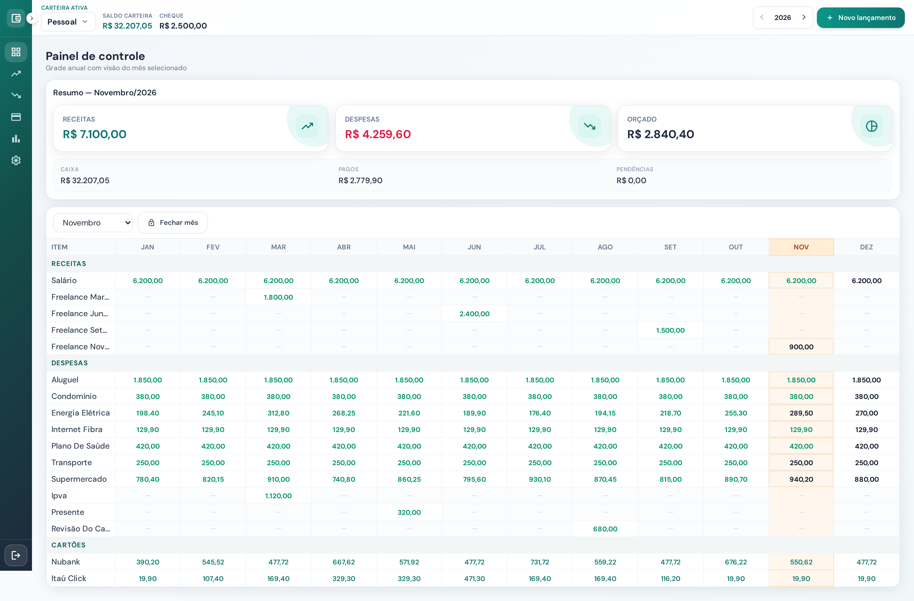
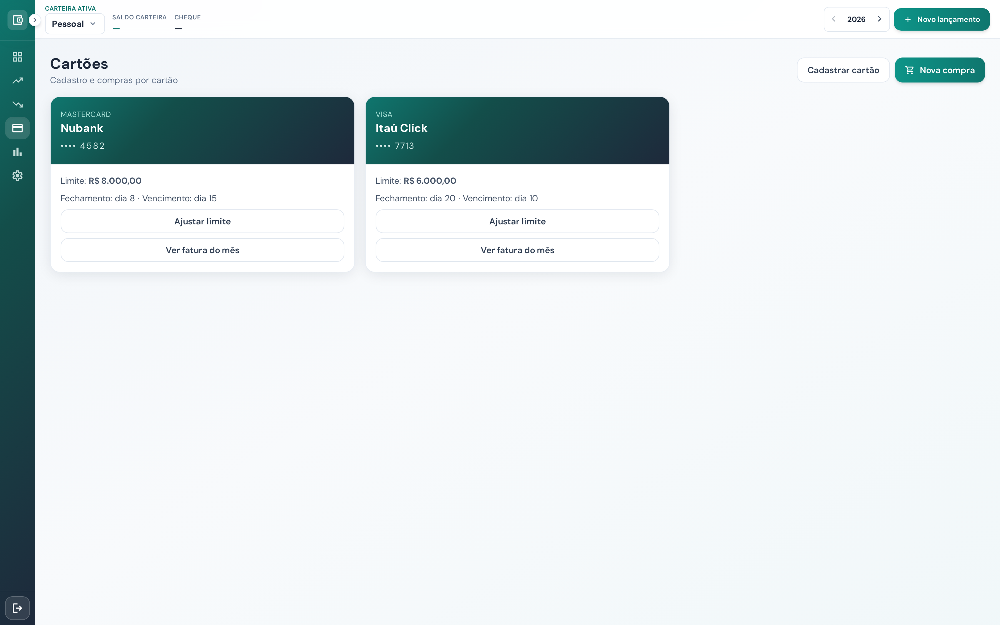
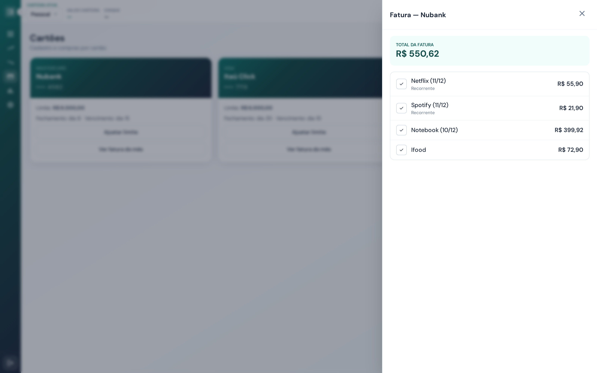

# FinFlow

**Status: em desenvolvimento**

Aplicação web de controle financeiro pessoal. Reúne, no mesmo lugar, a visão do ano, os lançamentos de receitas e despesas, os cartões com suas faturas e o fechamento de cada mês.

## O que já funciona

A tela principal é uma grade anual, de janeiro a dezembro. Nela você acompanha receitas, despesas e faturas de cartão mês a mês, com um resumo do período selecionado: saldo em caixa, cheque especial disponível, totais e pendências.

Os lançamentos podem ser únicos ou recorrentes. Em cartões, dá para cadastrar limite, dia de fechamento e vencimento, registrar compras à vista, parceladas ou recorrentes, e abrir a fatura do mês. O fechamento mensal consolida o saldo e marca o mês como fechado, deixando as pendências visíveis. O cheque especial entra no cálculo do caixa e impede pagamentos que ultrapassem o limite.

Há também relatórios do ano (receitas x despesas, saldo mensal e totais por categoria) e autenticação com cadastro, login, token JWT e refresh em cookie HttpOnly. É possível manter mais de uma carteira, nos tipos pessoal, empresarial ou conjunta.

## Prints



*Visão anual, com o resumo de novembro e o botão de fechar o mês.*



*Cadastro de cartões, com limite, fechamento e vencimento.*



*Detalhe da fatura, com itens recorrentes e parcelados.*

## Stack

| Camada | Tecnologias |
|--------|-------------|
| Backend | Python 3.11+, FastAPI, Pydantic v2, SQLAlchemy 2, Alembic, SQLite |
| Frontend | React 18, TypeScript, Vite, Tailwind, TanStack Query, Recharts |

## Como rodar localmente

Você precisa de Python 3.11+ e Node.js 18+.

### Backend

```bash
cd backend
python -m venv .venv
source .venv/bin/activate
pip install -r requirements.txt
python -m alembic upgrade head
python -m uvicorn app.main:app --reload
```

A API fica em [http://127.0.0.1:8000](http://127.0.0.1:8000) e a documentação OpenAPI em `/docs`.

No Windows, ative o ambiente com `.\.venv\Scripts\Activate.ps1`.

### Frontend

```bash
cd frontend
cp .env.example .env
npm install
npm run dev
```

A interface abre em [http://127.0.0.1:5173](http://127.0.0.1:5173). Com `VITE_API_BASE_URL` vazio (o padrão do `.env.example`), o Vite encaminha `/api` para o backend.

### Testes

```bash
cd backend
python -m pytest -q
```

## Estrutura

```
backend/
  app/
    main.py                 entrada da API
    api/                    rotas em /api/v1
    modulos/                auth, carteiras, lançamentos, cartões, fechamento
    nucleo_financeiro/      cálculos, grade e recorrência
  alembic/                  migrações
  testes/
frontend/
  src/funcionalidades/      telas da interface
docs/
```

## Próximos passos

Enquanto o projeto avança, os próximos ajustes que pretendo fazer são alinhar as migrações Alembic ao modelo atual (incluindo a coluna `usuarios.senha_hash`) e melhorar a escala do eixo Y nos gráficos de relatórios.
