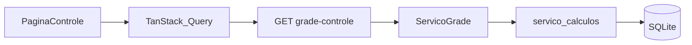

# Arquitetura FinFlow

## Monorepo

```text
controle_gastos/
  docs/           # documentação versionada
  backend/        # FastAPI + SQLAlchemy + Alembic + SQLite
  frontend/       # React + Vite + TypeScript + Tailwind
  README.md
```

## Camadas (backend)

```text
rotas (modulos/*/rotas.py)
  → servicos de módulo / nucleo_financeiro
    → dominio/ (funções puras, sem ORM)
      → modelos SQLAlchemy
```

| Camada | Responsabilidade |
|--------|------------------|
| `api/v1` | Montagem de routers |
| `modulos/*` | HTTP fino + orquestração CRUD |
| `nucleo_financeiro` | Pagamentos, cálculos, recorrência, fechamento, fluxo de caixa |
| `dominio` | Regras testáveis sem banco |
| `nucleo` | Config, sessão DB |

## Mapa DRY

| Preocupação | Único lugar |
|-------------|-------------|
| Totais / orçado / caixa / cheque_livre | `servico_calculos` |
| Marcar pago / validar cheque | `servico_pagamentos` |
| Gerar ocorrências mensais | `servico_recorrencia` |
| Fechar / reabrir mês | `servico_fechamento` (chama `servico_calculos`) |
| Grade anual agregada | `ServicoGrade` + `servico_calculos` |
| Cliente HTTP front | `compartilhado/api/cliente.ts` |
| Formatação R$ | `compartilhado/formatacao.ts` |
| Gaveta shell | `GavetaLateral` |
| Formulário receita/despesa | `GavetaFormularioLancamento` |
| Célula grade | `CelulaFinanceira` |
| Listagens | `PaginaLancamentos` (`tipo`) |

## Fluxo grade ↔ API



## Stack e boas práticas

### Backend

- **FastAPI**: routers por módulo; `Depends(obter_sessao)`; erros HTTP em PT.
- **Pydantic v2**: schemas entrada/saída separados; `Decimal` monetário.
- **SQLAlchemy 2**: `Mapped` / `select()`; `Numeric(14,2)`.
- **Alembic**: migrations incrementais; SQLite com `PRAGMA foreign_keys=ON`.
- **pytest**: domínio unitário + integração (grade, cheque, fechamento).

### Frontend

- **React 18 + TS strict**: pastas por feature; sem soma crítica no React.
- **Vite**: `VITE_API_BASE_URL`; alias `@/`.
- **TanStack Query**: chaves em `chavesConsulta.ts`; invalidação após mutations.
- **Tailwind**: tokens teal/slate (Stitch); Material Symbols.
- **React Router**: layout `CascoAplicacao` + rotas da sidebar.

### Tooling

- Backend: Ruff (`ruff.toml`).
- Frontend: ESLint + `tsc -b` no build.
- Bootstrap no startup: 1 carteira + 1 conta caixa (sem seed de planilha).
